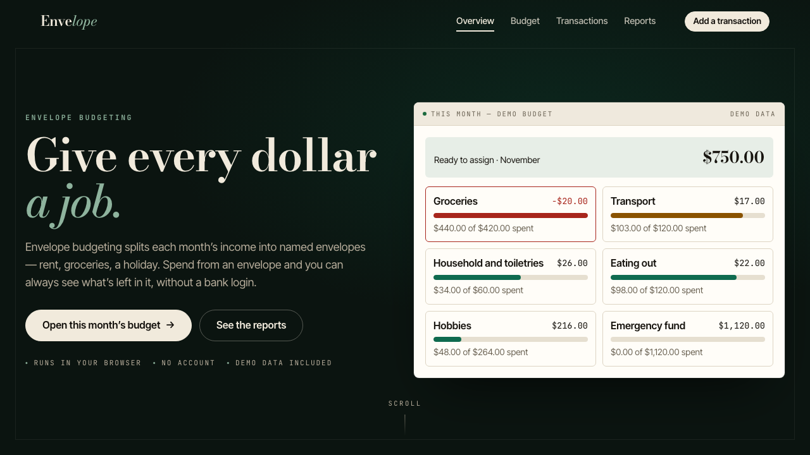
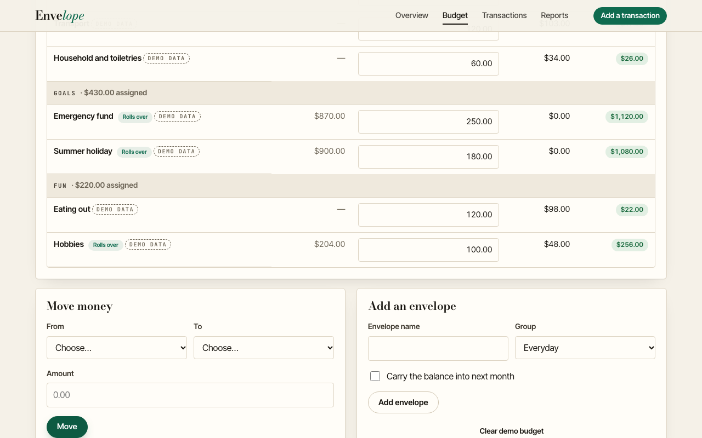
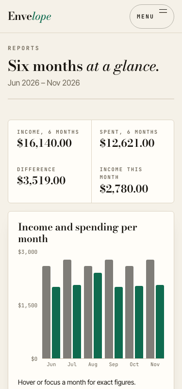

# Envelope

Envelope budgeting in the browser: record income, assign it to named envelopes each month, log spending against them, carry balances forward where it makes sense, and move money when plans change. An organisation tool, not financial advice.

**Live demo:** [https://envelope-planner.vercel.app/](https://envelope-planner.vercel.app/) — runs entirely in your browser; demo data is fictional and labelled.



| Budget | Mobile reports |
| --- | --- |
|  |  |

## Run it

```bash
npm install
npm run dev        # http://localhost:5206
npm test
npm run build
npm run test:e2e   # Playwright smoke test (npm run e2e:install once if Chromium is missing)
```

## Main workflow

1. The app opens with six months of labelled, fictional **demo data**: ten envelopes in four groups, salary and freelance income, everyday spending, one overspend and one emergency withdrawal. **Budget → Clear demo budget** removes it.
2. **Transactions** → add income or spending (date, payee, amount, envelope, note). The list filters by month, envelope and text, sorts, paginates and exports CSV.
3. **Budget** → pick a month. **Ready to assign** shows income not yet given a job. Type an amount for each envelope, or **Copy last month’s plan**. Each row shows carried-in, assigned, spent and available.
4. **Move money** between envelopes for the month when one runs short.
5. **Reports** → six-month income vs spending (legend, axis and exact figures on hover or focus) and assigned vs spent per envelope this month.

## Rules

- **Ready to assign** = all income up to and including the month − everything assigned up to then. Unassigned money carries forward.
- **Available** = assigned − spent for the month. Envelopes marked *Rolls over* also add last month’s available, including a negative balance from overspending.
- Moving money changes two allocations by the same amount, and can’t move more than the source has available.
- Allocations can’t be negative. Amounts are rounded to cents.

## Design

Shared editorial system: Bodoni Moda display type with italic accents, Inter Tight interface text, mono figures, an ink “ready to assign” band, envelope cards with fill bars that turn amber when low and red when overspent, and a warm paper workspace. Motion is disabled under `prefers-reduced-motion`.

## Tests

- `src/lib/budget.test.ts` — month shifting, totals, rollover on and off, overspending carried forward, ready to assign across months, copy and move, validation, spending trend.
- `src/App.test.tsx` — budget view, editing an allocation, move-money validation, adding spending, empty state and new envelope, report charts.
- `e2e/smoke.spec.ts` — landing, assign and move money with reload persistence, add a transaction, reports, plus 375px layout checks.

## Limitations

- Manual entry only; no bank connections or imports.
- One currency (US dollar formatting).
- No split transactions or scheduled transactions.

## Future improvements

- CSV import from a bank export; split transactions across envelopes; savings-goal targets.

## Licence

MIT — see [LICENSE](LICENSE).
